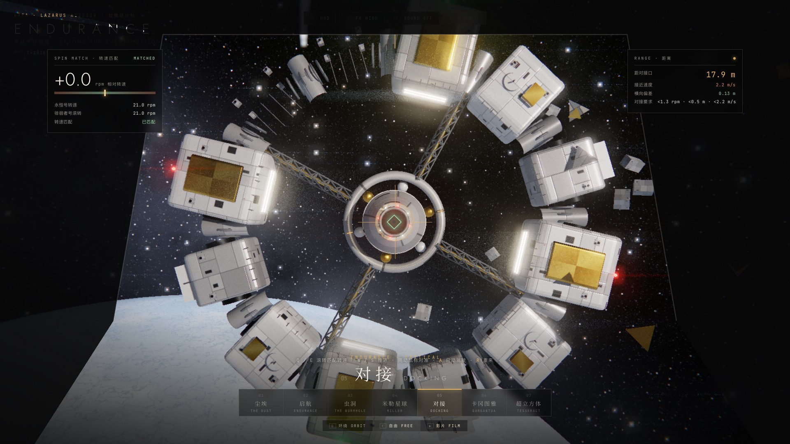

<div align="center">

# ENDURANCE · 穿越卡冈图雅

**一部在浏览器里实时渲染的太空电影，也是七个可以亲手操控的场景。**
*A real-time WebGL film and playground — Kerr black hole, wormhole, tidal waves, a spinning dock and the tesseract.*

**[▶ 在线体验 Live demo](https://ssasfaffssssssssa.github.io/endurance/)** · 纯前端 · 无需安装 · 无构建 · three.js r160


</div>

## 两种玩法

**观看影片** — 2 分 02 秒，八个章节：尘埃 → 启航 → 虫洞 → 米勒星球 → 对接 → 卡冈图雅 → 超立方体 → STAY。镜头、字幕、章节卡、地球 / 飞船双时钟和管风琴配乐全部由代码实时驱动。`空格` 暂停，`←` `→` 跳章节，`Esc` 进入探索。

**自由探索** — 任务控制台式的界面：飞船状态、任务进度、带实时曲线的相对论面板、观测者面板、三维物体标注。`1`–`7` 切换场景，拖动旋转、滚轮缩放，`O` 环绕 / `E` 自由，`H` 隐藏界面，`G` 画质，`M` 声音。

| 场景 | 可以做什么 |
|---|---|
| 01 尘埃 | 窗光里的尘埃落成线条：二进制坐标 / 摩尔斯电码 STAY |
| 02 启航 | 沙尘笼罩的地球，十二舱段环形的永恒号 |
| 03 虫洞 | 球形引力透镜：球里是另一个星系，球外的星光弯成爱因斯坦环 |
| 04 米勒星球 | 380 米潮汐巨浪卷着水雾逼近；每 1.25 秒“滴答”一声 = 地球过去一天 |
| **05 对接** | **小游戏**：永恒号失控旋转，驾驶徘徊者号匹配转速、对准、靠近。`Q`/`E` 滚转，`W`/`S` 推进，鼠标对准，`A` 自动驾驶，`R` 重来；手机有触屏按钮 |
| 06 卡冈图雅 | 克尔黑洞实时光线追踪；电影 / 物理两种模式；自旋 0 / 0.8 / 0.99 可切换；靠近时实时计算时间膨胀 |
| 07 超立方体 | 无限延伸的书架晶格，时间之线在其中发光 |

| | |
|---|---|
|  |  |
|  |  |
|  |  |

## 本地运行

```bash
python3 serve.py        # → http://localhost:8090
```

任何静态服务器都可以（需要通过 http 打开）。需要支持 WebGL2 的浏览器，建议戴耳机、按 `F` 全屏。

## 技术要点

- **旋转黑洞（克尔时空）**：每个像素在克尔–希尔德坐标里积分一条光线，`H = ½(|p|² − 1 − f L²)`。这个坐标下逆度规有解析形式，不需要处理转折点；梯度用中心差分，积分用二阶龙格–库塔。自旋为 0 时退化为史瓦西黑洞。吸积盘内边缘取对应自旋的最内稳定轨道（Bardeen–Press–Teukolsky 公式），红移用克尔顺行圆轨道的严格公式 `g = 1 / (uᵗ (1 − Ωλ))`；光学薄盘在掠射角下更亮，看起来有厚度。
- **星空**：程序化生成、亮度守恒、按像素张角抗锯齿的多层星场，加上带尘埃带的银河，所以被引力透镜拉伸后依然干净。光线在相互作用球外的弱场偏折用解析式补上，避免出现同心圆接缝。
- **永恒号**：程序化建模。圆角舱段分三种类型，三角桁架辐条、带加强肋的连接通道、RCS 推进器簇；面板贴图在 canvas 上生成，配法线贴图和粗糙度贴图；导航灯闪烁；投射阴影的光源会跟着飞船走。
- **环境光**：每个场景用 PMREM 预过滤一张程序化环境贴图，金属外壳反射的是真实存在的光源——吸积盘、土星、冰封星球、阴天的天空。
- **米勒巨浪**：指数分布的径向网格跟随相机；浪形前陡后缓，浪头向前卷出“唇”；逐像素有限差分法线、菲涅尔反射、波面透光、白沫和随风飘散的水雾粒子。
- **对接**：转速、横向偏差、接近速度三项判定；自动驾驶是时间的纯函数，影片和宣传片里直接复用。
- **后期**：HDR → Unreal Bloom → 自写的电影级收尾（ACES、变形宽银幕光斑、色差、胶片颗粒、暗角、径向扭曲转场）；按帧时间自适应分辨率。
- **配乐**：Web Audio 实时合成的管风琴（PeriodicWave 音栓：长笛 / 原音 / 簧管 / 踏板）、卷积混响、时钟滴答、巨浪低频、视界前的骤然静默。原创和声与动机，不使用电影原声。影片以音频时钟为主时钟，画面和音乐不会错位。

## 目录

```
index.html  css/app.css
js/main.js        状态机、导演、界面、自适应分辨率
js/film.js        分镜表、字幕、章节、地球 / 飞船时钟
js/audio.js       程序化配乐
js/hud.js         探索模式 HUD：面板、SVG 实时图表、三维标注
js/env.js         每个场景的环境光（PMREM）
js/post.js        后期管线
js/endurance.js   永恒号与徘徊者号的程序化模型、阴影跟随、导航灯
js/glsl/common.js 噪声、星空、克尔时空光线追踪
js/worlds/*.js    七个场景
js/promo.js       宣传片的逐帧导演脚本与封面
tools/lab.html    单场景调试台：?w=garg&shot=flyby&u=0.5
tools/render-promo.js  逐帧渲染宣传片 / 离线渲染配乐 / 渲染封面
tools/beats.py    分析音乐重音，把剪辑点吸附到节拍上
```

## 逐帧渲染宣传片

需要本机 Chrome、`playwright-core` 和 `ffmpeg`：

```bash
node tools/render-promo.js video out/promo_silent.mp4 60 3   # 1920×1080 60fps，三路并行
node tools/render-promo.js cover out                         # 16:9 与 3:4 封面
```

`index.html?promo` 下页面暴露 `render(t)`，每一帧都是时间的纯函数，所以可以任意并行、任意重渲。剪辑点写在 `js/promo.js` 的 `SEGMENTS` 里；`tools/beats.py 音乐文件` 会给出音乐的拍点和建议的卡点。

## 致谢与声明

- [three.js](https://threejs.org) r160（MIT）；地球贴图来自 three.js 示例（NASA Blue Marble / Black Marble 衍生）。
- 灵感来自 [oxomkbk/earth-migration](https://github.com/oxomkbk/earth-migration)。
- 同人致敬作品，与电影《星际穿越》及其版权方无关。所有字幕为原创文字，网页配乐为原创程序化生成；仓库不包含任何电影素材或原声。

MIT License
