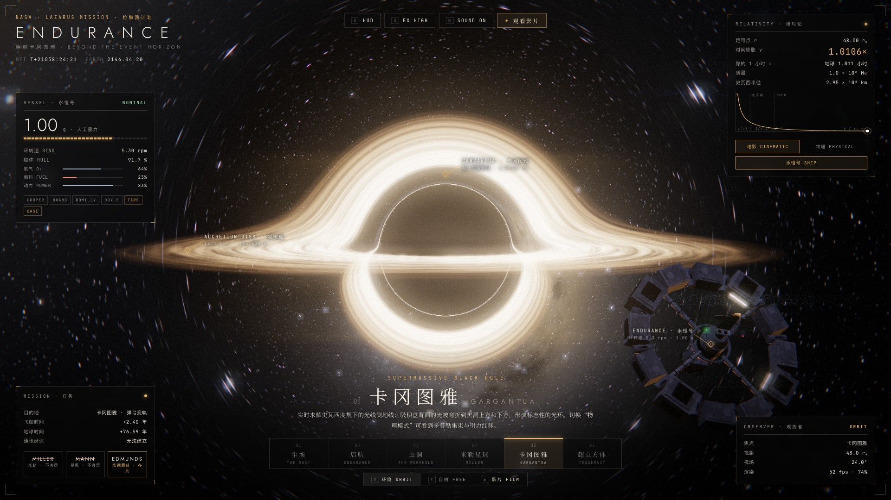
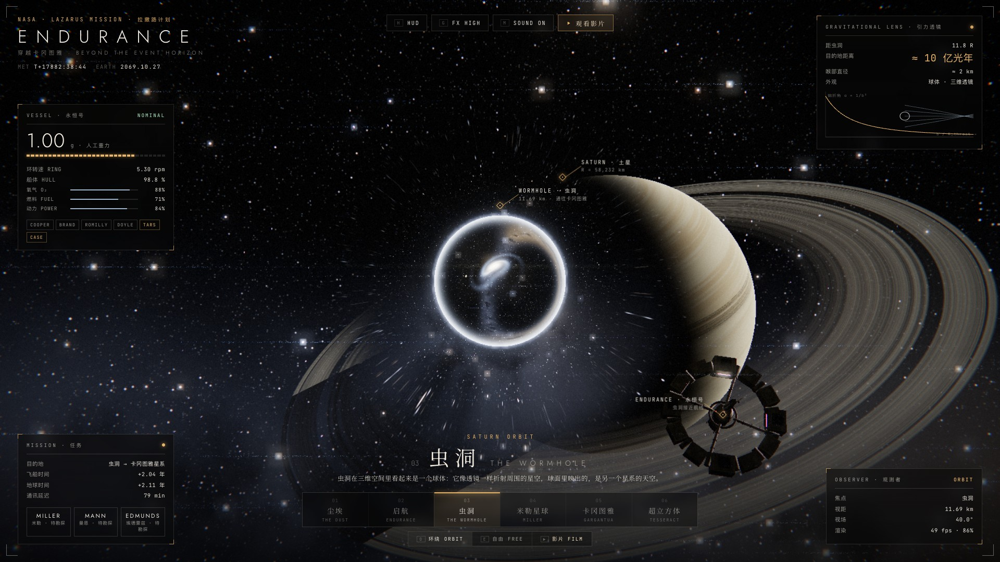
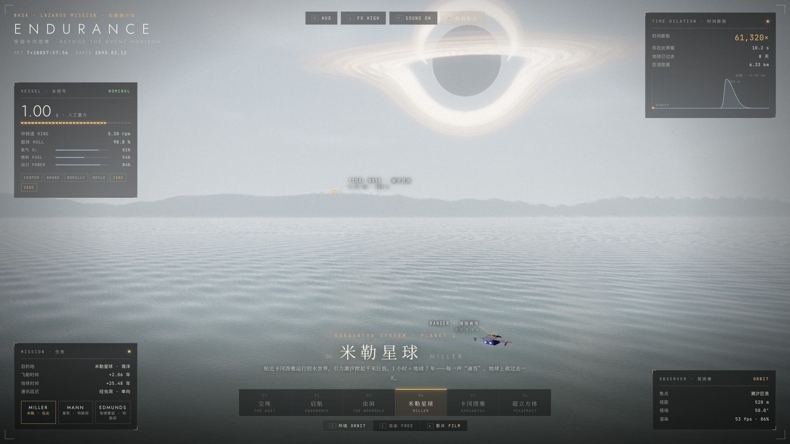
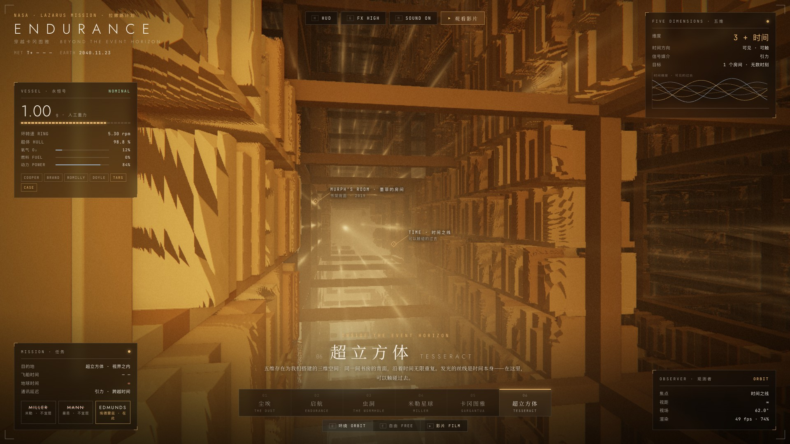
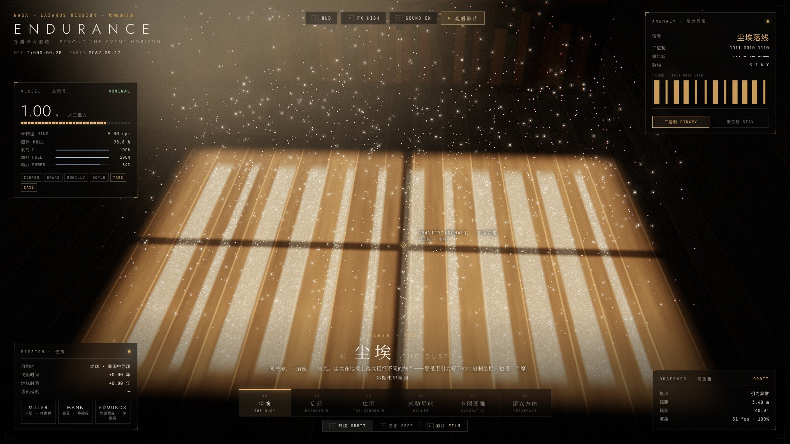
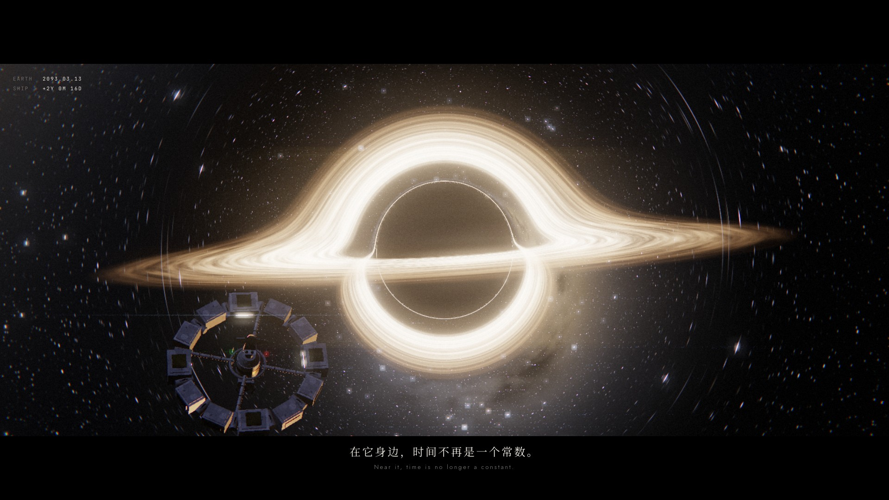
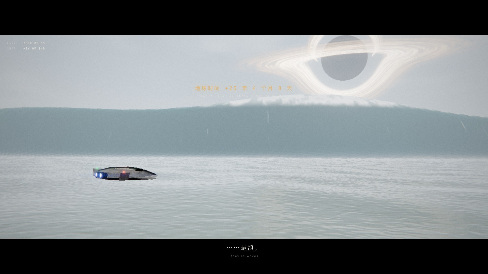

# ENDURANCE · 穿越卡冈图雅

**致敬《星际穿越》的实时 WebGL 影片与交互体验** · *A real-time WebGL film & playground, in tribute to Interstellar.*

纯前端、无构建、无 CDN 依赖（three.js r160 已内置）。一部 1 分 52 秒、七个章节的导演影片，加上六个可以亲手操控的场景。



| | |
|---|---|
|  |  |
|  |  |
|  |  |

## 运行

```bash
python3 serve.py        # → http://localhost:8090
```

任何静态服务器都可以（需通过 http 打开，不能直接双击 index.html）。需要支持 WebGL2 的浏览器，建议戴耳机、按 `F` 全屏。

## 两种模式

**观看影片** — 尘埃 → 启航 → 虫洞 → 米勒星球 → 卡冈图雅 → 超立方体 → STAY。镜头、字幕、章节卡、地球/飞船双时钟和配乐全部由代码实时驱动；支持暂停、拖动、章节跳转（`空格` `←` `→`）。

**自由探索** — 任务控制台式 HUD：飞船状态、任务进度、相对论面板（带实时曲线）、观测者面板、三维物体标注。六个场景任意切换（`1`–`6`），拖动旋转、滚轮缩放；`O` 环绕 / `E` 自由，`H` 隐藏界面，`G` 画质，`M` 声音：

| 场景 | 看点 |
|---|---|
| 01 尘埃 | 窗光里的尘埃落成线条：二进制坐标 / 摩尔斯电码 STAY，可切换 |
| 02 启航 | 沙尘笼罩的地球，十二舱段环形的永恒号 |
| 03 虫洞 | 球形引力透镜：球内是另一个星系，球外星光弯成爱因斯坦环 |
| 04 米勒星球 | 380 米潮汐巨浪逼近；每 1.25 秒“滴答”一声 = 地球一天 |
| 05 卡冈图雅 | **实时求解史瓦西度规下的光线测地线**；可切换电影模式 / 物理模式（多普勒集束 + 引力红移），靠近黑洞时实时计算时间膨胀 |
| 06 超立方体 | 光线步进的无限书架晶格，时间之线在其中发光 |

## 技术要点

- **黑洞**：每个像素积分一条零测地线 `x'' = −1.5·h²·x / r⁵`（r_s = 1），自适应步长 + Verlet 积分，进出相互作用球时补上弱场偏折；吸积盘按开普勒角速度旋转，两相剪切交叉淡化避免条纹无限缠绕；温度按 Novikov–Thorne 分布，物理模式加入相对论多普勒因子与引力红移。
- **星空**：程序化、通量守恒、按像素张角抗锯齿的多层星场 + 带尘埃带的银河，所以被引力透镜拉伸时依然干净。
- **米勒巨浪**：指数分布的径向网格跟随相机，前陡后缓的不对称波形，逐像素有限差分法线、菲涅尔反射、波面透光、浪尖白沫与雾。
- **后期**：HDR → Unreal Bloom → 自写电影收尾（ACES、变形宽银幕光斑、色差、胶片颗粒、暗角、径向扭曲转场）；按帧时间自适应分辨率。
- **配乐**：Web Audio 实时合成的管风琴（PeriodicWave 音栓：长笛 / 原音 / 簧管 / 踏板）、卷积混响、时钟滴答、巨浪低频、视界前的骤然静默。原创和声与动机，不使用电影原声。影片时间以音频时钟为主时钟，画面与音乐永不漂移。

## 目录

```
index.html  css/app.css
js/main.js        状态机、导演、界面、自适应分辨率
js/film.js        分镜表、字幕、章节、地球/飞船时钟
js/audio.js       程序化配乐
js/post.js        后期管线
js/endurance.js   永恒号与徘徊者号的程序化模型
js/glsl/common.js 噪声、星空、史瓦西测地线追踪
js/worlds/*.js    六个场景
js/hud.js         探索模式 HUD：面板、SVG 实时图表、三维标注
js/promo.js       抖音宣传片的逐帧导演脚本 + 封面
tools/lab.html    单场景调试台：?w=garg&shot=flyby&u=0.5
tools/render-promo.js  逐帧渲染宣传片 / 离线渲染配乐 / 渲染封面
```

## 逐帧渲染宣传片

需要本机 Chrome 和 `playwright-core`、`ffmpeg`：

```bash
node tools/render-promo.js video out/promo_silent.mp4 60 3   # 1920×1080 60fps，三路并行
node tools/render-promo.js audio out/promo.wav               # 离线渲染原创配乐
node tools/render-promo.js cover out                         # 16:9 与 3:4 封面
./tools/mux-promo.sh                                          # 合成并标准化到 -14 LUFS
```

`index.html?promo` 下页面暴露 `render(t)`，每一帧都是时间的纯函数，所以可以任意并行、任意重渲。

## 致谢与声明

- [three.js](https://threejs.org) r160（MIT），地球贴图来自 three.js 示例（NASA Blue / Black Marble 衍生）。
- 灵感来自 [oxomkbk/earth-migration](https://github.com/oxomkbk/earth-migration)。
- 同人致敬作品，与电影《星际穿越》及其版权方无关。所有字幕为原创文字，配乐为原创程序化生成。

MIT License
